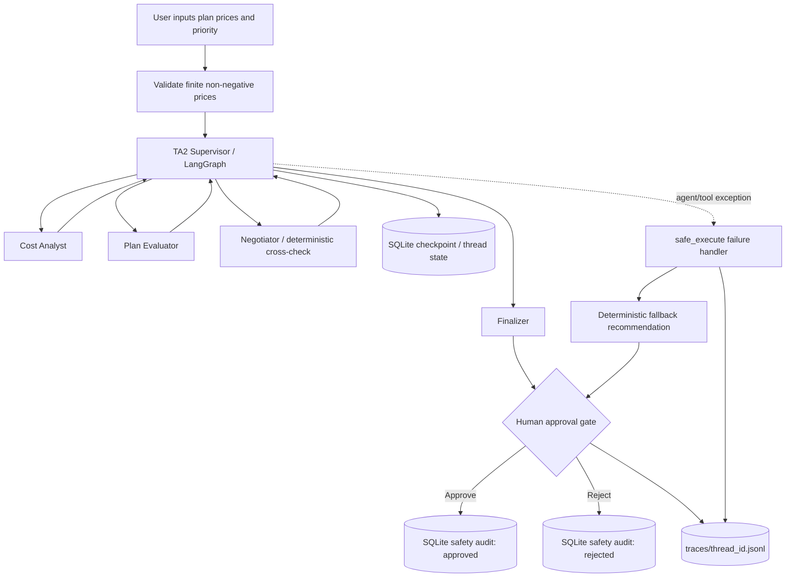

# Architecture Diagram — Subscription Cost Optimizer

## Safety properties

- TA1 remains frozen at `ta1/subscription_optimizer.py`; the original root entry point is also retained.
- `@tool`-decorated cost helpers reject negative and non-finite prices.
- The supervisor uses a maximum of three specialist hops and sends the available state to the finalizer at the limit.
- Agent/tool exceptions are captured and trigger a deterministic fallback; a fallback is still subject to human approval.
- Approval and rejection are both recorded. A rejected recommendation is never labelled approved.
- Trace files record workflow completion, tool failures, fallback usage and the human decision.
